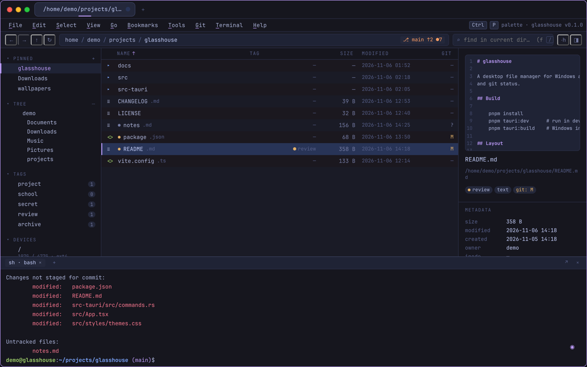

# glasshouse

[](https://github.com/Johnson-Anthony/glasshouse/actions/workflows/ci.yml)

> A desktop file manager for Windows and Linux, with tabs, a built-in terminal and git status.

**[Project page](https://johnson-anthony.github.io/glasshouse/)**, with a live demo you can try in the browser.



## What it is

Glasshouse is a desktop file manager built with Tauri 2 (Rust) and React 18 (TypeScript). It was written for Windows, to add what File Explorer lacks: an embedded terminal, tabs, archive handling and git status. It also runs on Linux, with Linux implementations of drives and mounts, trash, network stats and terminal sessions.

## Features

- **Tabs**, each with its own history. Private tabs aren't added to recent folders.
- **Terminal drawer** (xterm.js) with several shell tabs that follow the folder you're browsing. Profiles cover local shells, WSL distros and ssh hosts.
- **Git status**: repositories are detected with `libgit2`. The path bar shows the branch, the file list has a status column, and the Git menu can stage, commit, blame and switch branches.
- **Archives**: create and extract `.zip`, `.tar.gz`, `.tar.zst` and `.7z`. Zip is built in; the others use the system `tar` and 7-Zip.
- **Tags and bookmarks**, with sidebar filters for tags.
- **Search**: fuzzy search in the current folder, and find in files.
- **Themes**: 8 color themes. Dialogs and context menus are drawn by the app, so they follow the theme.
- **Inspector and status bar**: file details and previews (text, image, PDF, audio, hex), plus disk, memory, CPU and network stats.

## Stack

- **Frontend:** React 18, TypeScript, Vite, [xterm.js](https://xtermjs.org)
- **Backend:** Rust, Tauri 2, [`git2`](https://crates.io/crates/git2), [`notify`](https://crates.io/crates/notify), [`sysinfo`](https://crates.io/crates/sysinfo)
- **Tauri plugins:** `fs`, `dialog`, `shell`, `os`, `opener`
- **Package manager:** pnpm 9

## Install

Download a package from the [Releases page](https://github.com/Johnson-Anthony/glasshouse/releases). [CHANGELOG.md](CHANGELOG.md) lists what changed in each release.

- **Windows (x64):** the `.msi` or the `-setup.exe` installer. Either one downloads WebView2 if it's missing (Windows 11 already has it). The installers aren't signed, so SmartScreen warns the first time you run one: choose More info → Run anyway.
- **Linux (x64 and arm64):** a `.deb` or an `.AppImage` for each architecture: `amd64` and `arm64` for the `.deb`, `amd64` and `aarch64` for the `.AppImage`. They're built on Ubuntu 22.04, so they need glibc 2.35 or newer: Ubuntu 22.04, Debian 12, or anything newer.
  - `.deb`: `sudo apt install ./glasshouse_<version>_amd64.deb` installs it with its dependencies (WebKitGTK 4.1).
  - `.AppImage`: make it executable (`chmod +x glasshouse_*.AppImage`), then run it. AppImages need FUSE 2, which Ubuntu 24.04+ and Debian 13 don't install by default: `sudo apt install libfuse2t64` (`libfuse2` on older releases). Without FUSE, start it with `--appimage-extract-and-run`.

macOS isn't built or tested.

## Build from source

You need a Rust toolchain, Node 20+ and pnpm, plus:

- **Windows:** the [Tauri prerequisites](https://v2.tauri.app/start/prerequisites/) (WebView2, Visual Studio Build Tools).
- **Linux:** WebKitGTK 4.1 and its build dependencies: `webkit2gtk-4.1` (Arch) or `libwebkit2gtk-4.1-dev libgtk-3-dev librsvg2-dev patchelf` (Debian/Ubuntu).

```bash
pnpm install
pnpm tauri:dev                              # run in dev mode
pnpm tauri:build                            # Windows: .msi and .exe installers
pnpm tauri build --bundles appimage,deb     # Linux: .AppImage and .deb
```

## Project site

The project page in `docs/` includes a browser demo: the app's real interface over a stand-in backend that keeps its files in memory. To rebuild it after UI changes:

```bash
pnpm site:build              # demo bundle into docs/demo
pnpm site:capture            # images and clips into docs/media (needs chromium and ffmpeg)
pnpm site:capture check      # behavior checks in headless Chromium
```

## Status

In active development. File operations, tabs, the terminal, archives and git status work.

## License

MIT. See [LICENSE](LICENSE).
