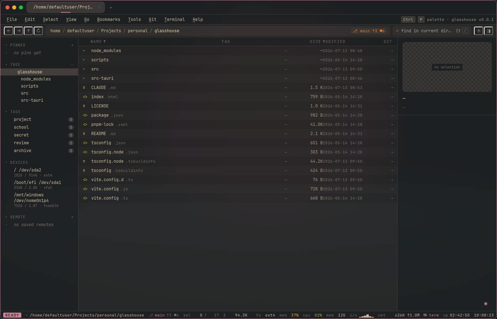

# glasshouse

[](https://github.com/Johnson-Anthony/glasshouse/actions/workflows/ci.yml)

> A desktop file manager for Windows and Linux, with tabs, a built-in terminal and git status.

**[Project page](https://johnson-anthony.github.io/glasshouse/)**



## What it is

Glasshouse is a desktop file manager built with Tauri 2 (Rust) and React 18 (TypeScript). It was written for Windows, to add what File Explorer lacks: an embedded terminal, tabs, archive handling and git status. It also runs on Linux, with Linux implementations of drives and mounts, trash, network stats and terminal sessions.

## Features

- **Tabs**, each with its own history. Private tabs aren't added to recent folders.
- **Terminal drawer** (xterm.js) with several shell tabs that follow the folder you're browsing. Profiles cover local shells, WSL distros and ssh hosts.
- **Git status**: repositories are detected with `libgit2`. The path bar shows the branch, the file list has a status column, and the Git menu can stage, commit, blame and switch branches.
- **Archives**: create and extract `.zip`, `.tar.gz`, `.tar.zst` and `.7z`. Zip is built in; the others use the system `tar` and 7-Zip.
- **Tags and bookmarks**, with sidebar filters for tags.
- **Search**: fuzzy search in the current folder, and find in files.
- **Themes**: 8 color themes. Dialogs and context menus are drawn by the app, so they follow the theme.
- **Inspector and status bar**: file details and previews (text, image, PDF, audio, hex), plus disk, memory, CPU and network stats.

## Stack

- **Frontend:** React 18, TypeScript, Vite, [xterm.js](https://xtermjs.org)
- **Backend:** Rust, Tauri 2, [`git2`](https://crates.io/crates/git2), [`notify`](https://crates.io/crates/notify), [`sysinfo`](https://crates.io/crates/sysinfo)
- **Tauri plugins:** `fs`, `dialog`, `shell`, `os`, `opener`
- **Package manager:** pnpm 9

## Run it

Pre-built binaries are on the [Releases page](https://github.com/Johnson-Anthony/glasshouse/releases): a Windows installer (`.msi` or `.exe`) and Linux packages (`.AppImage` and `.deb`). They're unsigned, so Windows SmartScreen shows a warning the first time you run the installer.

To build from source you need a Rust toolchain, Node 20+ and pnpm, plus:

- **Windows:** the [Tauri prerequisites](https://v2.tauri.app/start/prerequisites/) (WebView2, Visual Studio Build Tools).
- **Linux:** WebKitGTK 4.1 and its build dependencies: `webkit2gtk-4.1` (Arch) or `libwebkit2gtk-4.1-dev libgtk-3-dev librsvg2-dev patchelf` (Debian/Ubuntu).

```bash
pnpm install
pnpm tauri:dev                              # run in dev mode
pnpm tauri:build                            # Windows: .msi and .exe installers
pnpm tauri build --bundles appimage,deb     # Linux: .AppImage and .deb
```

## Status

In active development. File operations, tabs, the terminal, archives and git status work.

## License

MIT. See [LICENSE](LICENSE).
