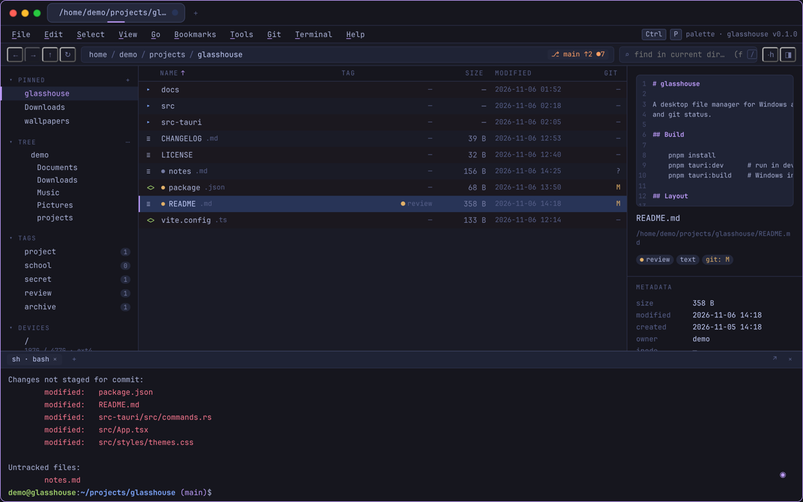

# glasshouse

> A desktop file manager for Windows and Linux, with tabs, a built-in terminal and git status.

**[Project page](https://johnson-anthony.github.io/glasshouse/)**, with a live demo you can try in the browser.

## What it is

glasshouse is a file manager for Windows 10 and 11 and for Linux. It was written to add what File Explorer lacks: a terminal that follows the folder you're in, tabs, archives, and git status for every file. It's free and open source (MIT), and it works offline: it has no account, no telemetry and no network connections of its own ([Privacy](#privacy)).

This page describes the current code. [CHANGELOG.md](CHANGELOG.md) lists what each release has, and its "Unreleased" section what's coming in the next one.

## Features

- **Tabs**, each with its own history. Private tabs aren't added to recent folders. The tabs you had open come back after a restart.
- **Terminal drawer** with several shell tabs that follow the folder you're browsing. Profiles cover your local shells, WSL distros on Windows, and ssh hosts from `~/.ssh/config`.
- **Git status**: the path bar shows the branch, the file list has a status column, and the Git menu can stage, commit, blame, pull, push and switch branches.
- **Archives**: create and extract `.zip`, `.tar.gz`, `.tar.zst` and `.7z`.
- **Previews and details**: the Inspector shows a file's details and a preview (text, image, PDF, audio, hex).
- **Search**: fuzzy search in the current folder, find in files, and find and replace in files with undo.
- **Undo and redo** for renames, moves, copies, Move to Trash and most other changes, and a Trash view with Restore.
- **Drag and drop with other apps**, in and out.
- **Tags and pins**, with tag filters in the sidebar.
- **Themes**: 39 light and dark themes, a System theme that follows the OS's light or dark setting, and an editor for your own. Fonts, the window's buttons and the file list's look are all yours to set in Preferences.
- **Keyboard first**: every menu works from the keyboard, and the command palette (Ctrl+P) finds every command.
- **It can be your file manager:** other apps' "Show in folder" and open-folder requests, and on Linux their open and save dialogs, can go to glasshouse. All of it is off until you turn it on ([below](#use-it-as-your-file-manager)).

## Install

Download a package from the [Releases page](https://github.com/Johnson-Anthony/glasshouse/releases). Each file name has the version and the processor type in it.

### Windows

| File | What it does | Who it's for |
|---|---|---|
| `glasshouse_<version>_x64-setup.exe` | Installs for your account only, in `%LOCALAPPDATA%\glasshouse`. No admin rights needed. | **Most people: pick this one.** |
| `glasshouse_<version>_x64_en-US.msi` | Installs for every user of the PC, in `Program Files\glasshouse`. Needs admin rights. | IT departments that deploy MSIs. |

Use the `arm64` files instead of the `x64` ones on a PC with an Arm processor (Settings → System → About → "System type" says which). The arm64 installers start with the first release after 0.2.0.

- **SmartScreen will warn you.** The installers aren't code-signed yet, so the first time you run one, Windows shows "Windows protected your PC": choose **More info → Run anyway**. The MSI's admin prompt says "Unknown publisher" for the same reason. To be sure a file is the real one, [check it](#checking-a-download) first.
- **WebView2:** glasshouse draws its window with Microsoft's WebView2 Runtime. Windows 11 has it, and so do most Windows 10 PCs. If it's missing, the installer downloads and installs it, which needs an internet connection that once.
- **Silent install:** `glasshouse_<version>_x64-setup.exe /S`, or `msiexec /i glasshouse_<version>_x64_en-US.msi /qn`.
- **Updating:** run the new version's installer of the same kind; it replaces the old version and keeps your settings. Over a 0.2.0 setup.exe install, the new setup's "Uninstall before installing" may stop with "Unable to uninstall!". If it does, run the setup again and choose "Do not uninstall", which installs over 0.2.0.
- Use one kind of installer, not both. To switch, uninstall the one you have first (your settings stay).

### Linux

| File | For |
|---|---|
| `glasshouse_<version>_amd64.deb`, `glasshouse_<version>_arm64.deb` | Debian, Ubuntu, Linux Mint, Pop!_OS and other distributions that use `apt`. |
| `glasshouse_<version>_amd64.AppImage`, `glasshouse_<version>_aarch64.AppImage` | Any other distribution. |

`uname -m` says which processor you have: `x86_64` takes the `amd64` files, `aarch64` the `arm64` and `aarch64` ones.

- **The .deb:** `sudo apt install ./glasshouse_<version>_amd64.deb`. apt also installs what it needs (WebKitGTK 4.1), and by default git, 7-Zip and xdg-utils, which some features use. To update, install the new .deb the same way: glasshouse isn't in an apt repository, so apt doesn't update it by itself.
- **The AppImage:** make it executable (`chmod +x glasshouse_*.AppImage`), then run it. It carries its own copy of WebKitGTK. AppImages need FUSE 2, which many distributions don't install by default: `sudo apt install libfuse2t64` on Ubuntu 24.04 and later and Debian 13 (`libfuse2` on older releases), `fuse-libs` on Fedora, `fuse2` on Arch. Without it, start the AppImage with `--appimage-extract-and-run`. An AppImage doesn't add itself to your app menu. To update, replace the file with the new one (if you've turned on [the integration settings](#use-it-as-your-file-manager) and the new file has another name or folder, turn them off and on again).

### System requirements

| | Windows | Linux |
|---|---|---|
| **System** | Windows 10 or 11 | glibc 2.35 or newer: Ubuntu 22.04, Debian 12, Fedora 36 and later, and most distributions from 2022 on |
| **Processor** | x64, or Arm64 | x86-64, or arm64 (aarch64) |
| **Web view** | WebView2 Runtime (the installer adds it if it's missing) | WebKitGTK 4.1 (the .deb pulls it in; the AppImage has its own) |
| **Desktop** | | Any desktop or compositor, on X11 or Wayland |

Some features use other programs, found on your PATH, and show an error when they're missing:
- **git** for the Git menu's Commit, Pull, Push, Fetch, Stash, Checkout, Merge and Rebase, its branch lists, and a file's last commit in the Inspector. The status column, the branch in the path bar, Stage, Unstage, Discard and Blame work without it.
- **7-Zip** for `.7z` archives. On Linux it's the `7zip` or `p7zip-full` package. On Windows, install it from [7-zip.org](https://www.7-zip.org), then add its folder (`C:\Program Files\7-Zip`) to your PATH, because its installer doesn't.
- **tar** for `.tar.gz` and `.tar.zst`. Windows 10 and 11 and every Linux distribution have it.
- **xdg-desktop-portal 1.17 or newer** for glasshouse as other apps' open and save dialog (Linux: Debian 13, Ubuntu 24.04, Fedora 39 and later).

## Use it as your file manager

Installing glasshouse doesn't change which app opens folders. You choose that in **Edit → Preferences → Integration**, and turning a setting off puts back what was there before:
- **Open folders with glasshouse:** folders that other apps open, and on Windows folders you double-click in Explorer, open in glasshouse.
- **Show files for other apps** (Linux): a browser's "Show in folder" and similar commands open glasshouse with the file selected.
- **Use glasshouse for open and save dialogs** (Linux): glasshouse's window becomes the Open, Save As, attach and upload dialog of every app it can reach, with nothing to set up per app.

From a terminal, `glasshouse --integration-on folders file-manager dialogs` turns them on (on Windows, `glasshouse.exe --integration-on folders`, in the folder it's installed in) and `glasshouse --integration-off` turns them all off. `glasshouse PATH…` opens a folder, or a file's folder with the file selected.

On Windows, Explorer's own "Show in folder", Win+E and other apps' open and save dialogs stay Windows' own; Windows doesn't let another app take those over. [docs/INTEGRATION.md](docs/INTEGRATION.md) explains what each setting changes and how each Linux desktop behaves.

## Privacy

glasshouse doesn't collect anything and makes no network connections of its own: no telemetry, no crash reports, no account. Its window is only allowed to talk to the app itself (its Content Security Policy has `connect-src 'self' ipc: http://ipc.localhost`), so it doesn't load remote images, fonts or scripts either.

What reaches the network is what you start:
- git's Pull, Push and Fetch, and ssh in the terminal, connect where you point them, as they do outside glasshouse;
- links you open, and Help → Documentation, Release Notes, Report Bug… and Check for Updates, open in your web browser.

On Windows, the installer downloads the WebView2 Runtime from Microsoft if the PC doesn't have it. The web view that draws the window is part of the system and updated with it: WebView2 on Windows, WebKitGTK with the .deb. The AppImage carries its own WebKitGTK, which a newer AppImage updates.

**Update checks (planned).** An update check is being added, off by default. When you turn on "Check for updates automatically" in Preferences (at most once a day), or choose Help → Check for Updates, glasshouse fetches the latest release's `latest.json` from GitHub and sends nothing else. An update installs only when you say so. Until then, Help → Check for Updates opens the Releases page in your browser.

## Your data, and uninstalling

glasshouse keeps your pins, tags, saved remotes, recent folders, window size and settings in two folders:
- **Linux:** `~/.config/io.github.johnson-anthony.glasshouse` and `~/.local/share/io.github.johnson-anthony.glasshouse` (settings and tabs, in the web view's storage).
- **Windows:** `%APPDATA%\io.github.johnson-anthony.glasshouse` and `%LOCALAPPDATA%\io.github.johnson-anthony.glasshouse`.

Up to 0.2.0 they were named `sh.glasshouse.viles`, and saved remotes were in `~/.glasshouse`. A newer version moves them the first time it starts.

**Uninstalling:**
- **Windows:** uninstall it in Settings → Apps. Both uninstallers turn "Open folders with glasshouse" off. The setup.exe's uninstaller also deletes the two folders if you tick "Delete the application data"; the MSI's never does, so delete them yourself if you want them gone.
- **Linux:** turn the integration settings off first (Preferences → Integration, or `glasshouse --integration-off`), because a package manager can't remove files from your home folder ([why, and what's left if you forget](docs/INTEGRATION.md#uninstalling)). Then `sudo apt remove glasshouse`, or delete the AppImage. Delete the two folders if you want your settings gone too.

Otherwise the folders stay, so a reinstall starts where you left off.

## Checking a download

Releases after 0.2.0 have a `SHA256SUMS` file with each package's SHA-256. Download it next to the package, then:
- **Linux:** `sha256sum -c SHA256SUMS --ignore-missing` in that folder. It prints `OK` for each file you have.
- **Windows:** `Get-FileHash .\glasshouse_<version>_x64-setup.exe` in PowerShell, and compare the hash with that file's line in `SHA256SUMS`.

With the [GitHub CLI](https://cli.github.com), `gh attestation verify glasshouse_<version>_x64-setup.exe --repo Johnson-Anthony/glasshouse` also checks that this repository's release workflow built the file.

## Known limitations

- **No code signing yet,** so SmartScreen warns about the Windows installers ([above](#windows)).
- **No macOS version.** It isn't built or tested.
- **English only.** The interface isn't translated.
- **No automatic updates yet.** The update check is being added, off by default ([Privacy](#privacy)). The .deb won't update itself: install each new .deb.
- **Windows has had less use than Linux.** CI builds glasshouse, runs its tests and opens its window on Windows, but fewer people have used it on real PCs. [Reports](#getting-help) are welcome.
- glasshouse as the open and save dialog is Linux only, and needs xdg-desktop-portal 1.17 or newer (not Debian 12 or Ubuntu 22.04).

## Getting help

- **Bugs:** [open an issue](https://github.com/Johnson-Anthony/glasshouse/issues/new/choose) (Help → Report Bug… goes there too). Say which version (Help → About), how you installed it, your OS and, on Linux, your desktop. Help → Open Log Folder (planned) will open the folder with the app's log, to attach.
- **Ideas:** the same page has a feature request form.
- **Security problems:** report them privately; [SECURITY.md](SECURITY.md) says how.

## Contributing

[CONTRIBUTING.md](CONTRIBUTING.md) covers building from source, the checks CI runs, and how the code is laid out. Manual test checklists for what CI can't drive are in [docs/testing/](docs/testing/README.md).

## License

MIT. See [LICENSE](LICENSE). Help → Third-party Notices lists the licenses of the libraries and fonts it includes.
